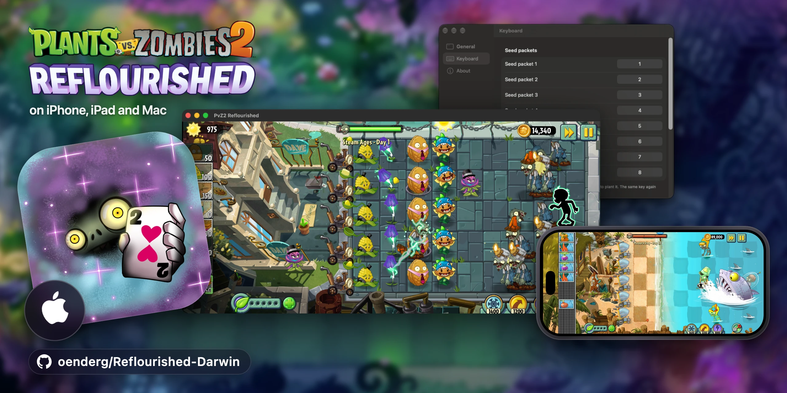
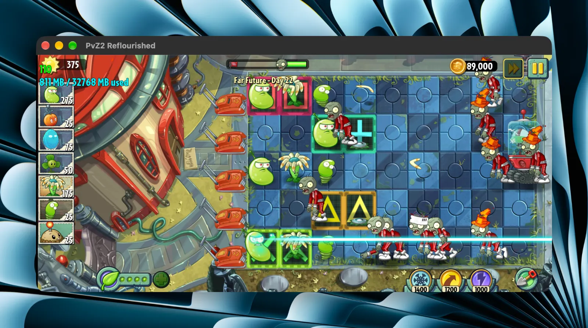
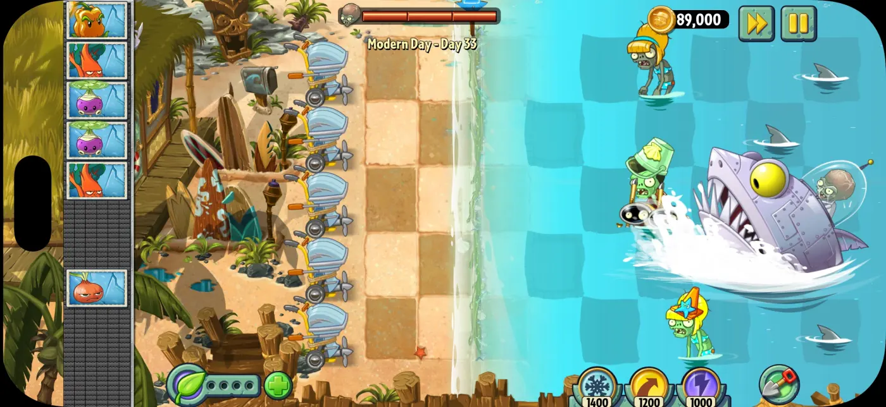
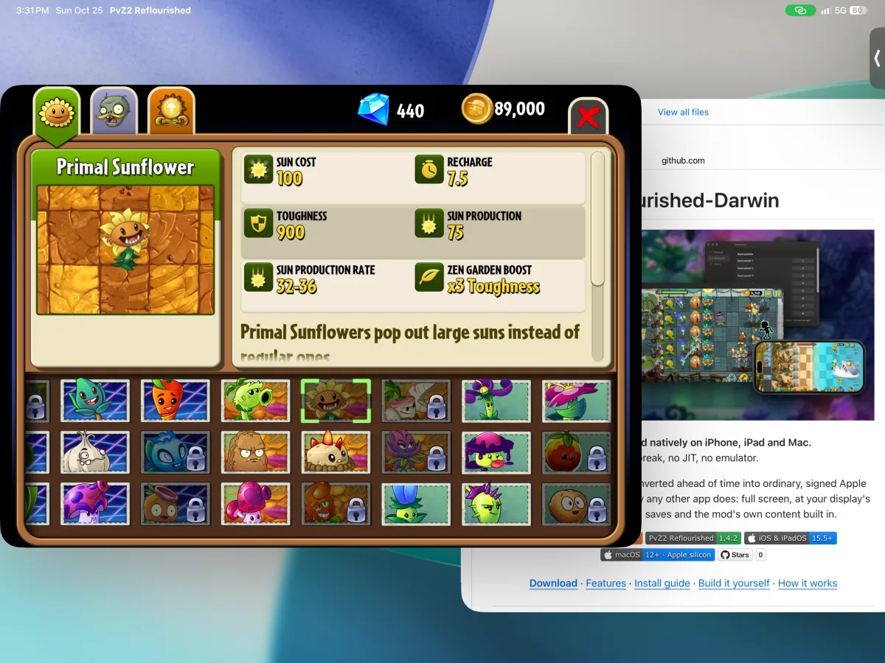
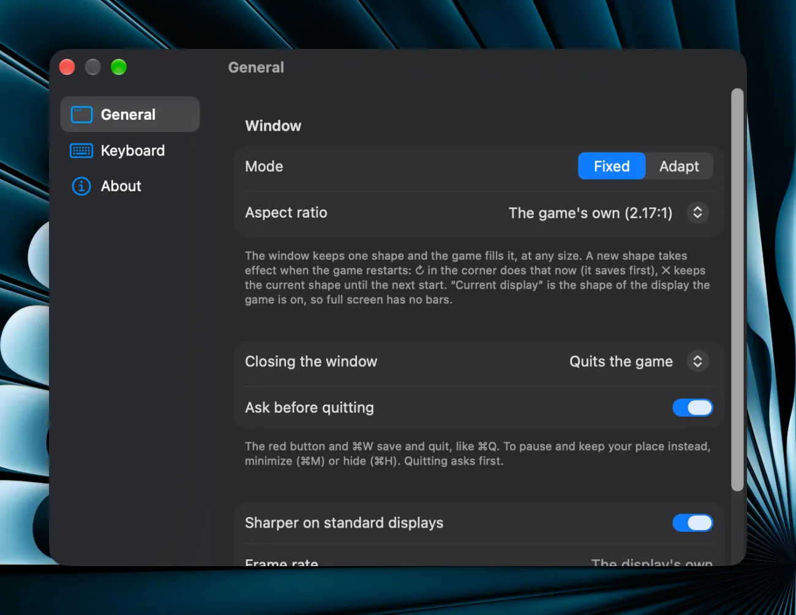
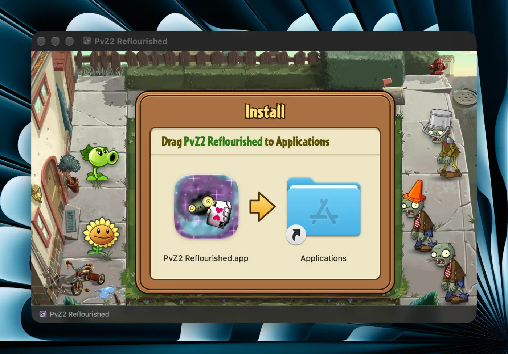

<h1 align="center">Reflourished-Darwin</h1>

<p align="center">
  
</p>

<p align="center"><b>PvZ2: Reflourished natively on iPhone, iPad and Mac.</b><br>No jailbreak, no JIT, no emulator.</p>

<p align="center">
The mod's Android code is converted ahead of time into ordinary, signed Apple code, so the game
runs the way any other app does: full screen, at your display's refresh rate, with sound, saves
and the mod's own content built in.
</p>

<p align="center">
  <a href="https://github.com/oenderg/Reflourished-Darwin/releases/latest"></a>
  <a href="https://github.com/oenderg/Reflourished-Darwin/releases"></a>
  
  
  
  <a href="https://github.com/oenderg/Reflourished-Darwin/stargazers"></a>
</p>

<p align="center">
  <a href="https://github.com/oenderg/Reflourished-Darwin/releases/latest"><b>Download</b></a> ·
  <a href="#features">Features</a> ·
  <a href="#install">Install guide</a> ·
  <a href="#build-it-yourself">Build it yourself</a> ·
  <a href="#how-it-works">How it works</a>
</p>

---

## Features

* **A real app**
  * Full screen, with sound, saves and the mod's own content built in.
  * Leaving the app pauses the game; coming back shows its pause menu.
  * Import/Export saves, quests and levels through the game's own menu.
* **Unlocked frame rate**
  * The game runs at your display's refresh rate: 120 Hz on ProMotion displays.
* **Touch, mouse and trackpad** work as on Android.
* **Keyboard** (Mac, and iPad with a keyboard)
  * `1`-`8` take a seed packet, `S` the shovel.
  * `Space` collects every sun and coin on the lawn.
  * `Esc` pauses and resumes. The keys rest while the game is paused.
  * On the Mac, Settings (`Cmd-,`) lets you pick any keys.
* **Mac window**
  * Keeps the game's shape at any size, or, in Settings, adapts to any shape from 4:3 to 21:9.
  * Drawn at the sharpness of the display it is on; Settings can draw it sharper on a
    display that isn't Retina.
  * `Cmd-M` and `Cmd-H` pause the game.
  * Closing the window quits, or keeps the game paused if you choose that in Settings.
    Quitting asks first (Settings, or "Don't ask again", turns that off).
* **Updates**
  * The Mac app updates itself: it checks once a day and asks before it installs
    (PvZ2 Reflourished > Check for Updates…).
  * iPhone and iPad get updates through AltStore and SideStore with this repository's source.
  * Your saves stay, and a full app needs no second 1.3 GB download.

<details>
<summary><b>Screenshots</b></summary>
<br>

<table>
  <tr>
    <td align="center" valign="top">
      <br>
      <sub><b>Mac</b> - with the performance overlay.</sub>
    </td>
    <td align="center" valign="top">
      <br>
      <sub><b>iPhone</b> - clear of the Dynamic Island.</sub>
    </td>
    <td align="center" valign="top">
      <br>
      <sub><b>iPad</b> - in a window, next to your other apps.</sub>
    </td>
  </tr>
</table>

<table>
  <tr>
    <td align="center" valign="top">
      <br>
      <sub><b>Settings</b> - window shape, sharpness, keys.</sub>
    </td>
    <td align="center" valign="top">
      <br>
      <sub><b>Install</b> - drag it to Applications.</sub>
    </td>
  </tr>
</table>

</details>

## Install

Every [release](https://github.com/oenderg/Reflourished-Darwin/releases/latest) has two
downloads for each platform:

| File | What it is |
|---|---|
| `PvZ2-Reflourished-<game>-Darwin-<version>-iOS.ipa` | iPhone and iPad, slim (about 60 MB) |
| `PvZ2-Reflourished-<game>-Darwin-<version>-iOS-Full.ipa` | iPhone and iPad, with the game's data inside (about 1.3 GB) |
| `PvZ2-Reflourished-<game>-Darwin-<version>-Mac.dmg` | Mac, slim |
| `PvZ2-Reflourished-<game>-Darwin-<version>-Mac-Full.dmg` | Mac, with the game's data inside |

A slim app downloads the game's data (1.3 GB) the first time it opens and checks it, so keep
it open on Wi-Fi until the game starts.

**iPhone / iPad** (iOS 15.5 or later) - install the IPA with SideStore, AltStore,
Sideloadly or LiveContainer.

**AltStore / SideStore source** - add
`https://raw.githubusercontent.com/oenderg/Reflourished-Darwin/main/altstore/source.json`
(Sources → +) and install the game from it; new releases then show up as updates.

**Mac** (Apple silicon, macOS 12 or later) - open the DMG and drag the app onto
Applications. The app is not notarized, so the first time macOS refuses to open it:
click **Done**, then in **System Settings → Privacy & Security** click **Open Anyway**.
After that the app updates itself.

Your saves live with the app (on the Mac, in `~/Library/Application Support/PvZ2 Reflourished`).

## Build it yourself

You need the **PvZ2 Reflourished 1.4.2** APK from the mod's official download (the MEGA or
Google Drive folder). You don't need the OBB that is next to it there: the build downloads
the same file from a copy on GitHub by itself and checks it. To use your own copy instead,
pass it with `--obb` (or the workflow's OBB link).

### Option A - let GitHub build it (no Mac needed)

1. **Fork** this repository.
2. In your fork, open the **Actions** tab and enable workflows.
3. Pick **Build → Run workflow**, paste a link to the APK (a direct link, Google Drive or
   MEGA), and start it.
4. When it finishes (up to an hour), the apps are in your fork's **Releases**.

### Option B - build it on your Mac

Needs Xcode (with its iOS platform) and about 8 GB of free space.

```sh
git clone https://github.com/oenderg/Reflourished-Darwin
cd Reflourished-Darwin
./build.sh --apk "PvZ2 Reflourished 1.4.2.apk" --slim
```

The results land in `out/`. Add `--ios` or `--mac` to build just one of them; leave out
`--slim` for apps with the game's data inside (about 1.3 GB more).

## Known issues

* Tested on one iPhone so far.

## How it works

The game's native libraries (`libPVZ2`, the mod's `libRFLib` and their helpers) are
translated from Android's ELF format into Mach-O dylibs at build time, with the mod's
290 code hooks written straight into the converted code. A small host - built on
[Husk](https://github.com/leviidev/husk) - provides what Android would have: the
JNI calls the game makes, its file system, OpenGL ES through ANGLE over Metal, audio,
touch and keyboard input, and the app's lifecycle.

| Folder | What is in it |
|---|---|
| `converter/` | ELF → Mach-O conversion and the hook bake |
| `runtime/` | the host: Android and JNI environment, graphics, audio, input, iOS and Mac apps |
| `data/` | the mod's recorded hook table and the game version it matches |
| `prebuilt/` | ANGLE for iOS and the iOS Simulator (rebuild with `REBUILD_ANGLE=1 ./build.sh …`) |
| `scripts/` | downloads, the disk image, the AltStore source, the Mac test runner |
| `docs/` | how it works, testing, the game's internals, releasing |

More in [docs/ARCHITECTURE.md](docs/ARCHITECTURE.md).

## Contributing

Fixes and improvements are welcome. [CONTRIBUTING.md](CONTRIBUTING.md) has the build loop and what a
good pull request shows; [docs/TESTING.md](docs/TESTING.md) how to test on a Mac without touching your
own game; [docs/GAME-NOTES.md](docs/GAME-NOTES.md) what the game does that is not obvious. Coding
agents start at [AGENTS.md](AGENTS.md). Found a bug? Open an issue with the app's log.

## Thanks

The **PvZ2 Reflourished** team for the mod, **Husk** for the translation layer this
is built on, and **ANGLE** (WebKit and Chromium) for OpenGL ES on Metal.
